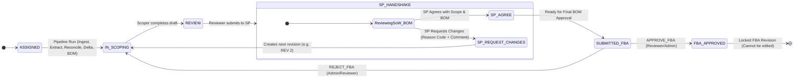

# ScopeIQ: Implementation Plan for Section 6.2 (Site Build BOM Scoping)

> **Document Reference:** `ScopeIQ_Internal_Team_Guide.docx`  
> **Target Scope:** Sections **6.1 (Site Design Scoping)** and **6.2 (Site Build BOM Scoping)** ONLY.  
> **Explicit Exclusion:** Section **6.3 (Network Deployment Scoping)** is **OUT OF SCOPE**.

---

## 1. Scope Boundary: 6.2 vs 6.3

According to `ScopeIQ_Internal_Team_Guide.docx` (Paragraphs 20–29 and 156–221):

```
┌─────────────────────────────────────────────────────────────────────────────┐
│                            IN SCOPE (Up to 6.2)                             │
├─────────────────────────────────────────────────────────────────────────────┤
│ 6.1 Site Design Scoping (Design Stream):                                    │
│   • Document ingestion & revision check (CD, RFDS, MA, SA)                  │
│   • Cross-source reconciliation (CD vs Drone vs RFDS)                       │
│   • Redlines & RFIs generation                                              │
│   • A&E Engineer review & turnaround                                        │
│                                                                             │
│ 6.2 Site Build BOM Scoping (BOM Stream):                                    │
│   • Equipment Delta / SoW Summary (Install, Remove, Relocate, Existing)     │
│   • BOM Generation (Kitting rules, Carrier REV 0 vs Generated REV 1 diff)   │
│   • CX SP Handshake (Scope of Work & BOM review by Construction Provider)   │
│   • Handshake Actions (SP Agree -> SUBMITTED_FBA, Request Changes -> REV 2) │
│   • Final BOM Approval (FBA) (Reviewer/Admin sign-off, Locked BOM export)   │
└─────────────────────────────────────────────────────────────────────────────┘
                                      ▼
┌─────────────────────────────────────────────────────────────────────────────┐
│                       OUT OF SCOPE (Section 6.3 EXCLUDED)                   │
├─────────────────────────────────────────────────────────────────────────────┤
│ 6.3 Network Deployment Scoping (Deployment Stream) - DO NOT IMPLEMENT:      │
│   ✗ Add FPP Service Drivers (driver matrix, labor line items)               │
│   ✗ Site Requirements / DPP (crane days, manlift days, rigging class B)     │
│   ✗ EH&S Safety Alerts & Mitigations                                        │
│   ✗ Cycle-Time Calculator (cycle-time model & days estimate)                │
│   ✗ SP Dollar Quote Negotiation & Variance Check (≤5% Match, 5-10% Warning, │
│     >10% Out of Tolerance)                                                  │
└─────────────────────────────────────────────────────────────────────────────┘
```

> [!IMPORTANT]
> The dollar quote submission, variance thresholds (≤5% MATCH, 5-10% TOLERANCE WARNING, >10% OUT OF TOLERANCE), FPP service drivers, crane/manlift days, and cycle-time model belong exclusively to **Section 6.3**.  
> Under **Section 6.2**, the **CX SP Handshake** is strictly a **Scope of Work (Equipment Delta) and BOM Review**, where the construction service provider agrees to the equipment changes or requests scope changes before **Final BOM Approval (FBA)**.

---

## 2. Requirements of Section 6.2 ("Site Build BOM Scoping")

As defined in the guide table (Paragraphs 178–199):

| RFP Activity | Manual Today | ScopeIQ Automation (Section 6.2) | Deliverable / Output |
| :--- | :--- | :--- | :--- |
| **1. Download Documentation** | Pull drone survey, RFDS, CDs, MA/SA | Shared-folder pickup and extraction | Document registry with active current revisions |
| **2. Scope of Work (SoW) Summary** | Summarize scope in scoping template | Generated from the **Equipment Delta** | Sector & position breakdown (Install, Remove, Relocate, Existing) |
| **3. Create BOM** | Validate REV 0; create REV 1; upload to Ericsson tool | Line-by-line comparison with REV 0; REV 1 generated by kitting rules | Material Catalog BOM + REV 0 vs REV 1 diff + Excel export |
| **4. SoW & BOM Submission / CX SP Handshake** | Meetings with SP to agree BOM | SP comments captured as change requests on a new revision | SP Handshake: `SP_AGREE` or `SP_REQUEST_CHANGES` (with reason code) |
| **5. BOM Approval (FBA)** | Final approval in tool of record | Locked FBA revision; export final package | State: `FBA_APPROVED`; **Locked FBA revision (read-only)** |

---

## 3. Workflow & State Machine for Section 6.2

The lifecycle for a site progressing through 6.2 is defined in `workflow_states.csv` and `workflow_transitions.csv`:



---

## 4. Current Code Audit & Gap Analysis

| Component | Current State | 6.2 Gap / Necessary Adjustment |
| :--- | :--- | :--- |
| **`Handshake.tsx`** | Currently has 6.3 components (Dollar quote input, Variance rules banner, FPP drivers, Crane/manlift requirements). | **Remove 6.3 sections**: remove quote form, variance rules, driver matrix, and crane requirements.<br>**Add 6.2 sections**: Equipment Delta (SoW), BOM REV 0 vs REV 1 summary, Download BOM link, SP Change Requests history, and FBA sign-off. |
| **Backend `estimate.py`** | Has `POST /sites/{site_id}/quote` with 5%/10% tolerance logic. | Cleanly keep or separate quote APIs so handshake endpoint focuses on **SoW & BOM agreement** and **FBA readiness**. |
| **Backend `workflow.py`** | Handles `SP_AGREE` and `SP_REQUEST_CHANGES`. | Add explicit support for `APPROVE_FBA` (transitions `SUBMITTED_FBA` $\rightarrow$ `FBA_APPROVED`), locking the revision permanently (`LOCKED = 1`). |
| **BOM Locking** | BOM can currently be queried at any time. | When state is `FBA_APPROVED`, enforce **Read-Only / Locked** badge and prevent line edits. |
| **Export Locked BOM** | Excel download exists in `BomView.tsx`. | Add direct "Download Approved FBA BOM (.xlsx)" button on the Handshake screen once approved. |

---

## 5. Implementation Steps for 6.2

### Step 1: Streamline Handshake UI (`Handshake.tsx`) for Scope & BOM Agreement
Replace the 6.3 quote & variance widgets with the dedicated 6.2 SoW & BOM Handshake view:
1. **Handshake Header**:
   - Status badge (`SP_HANDSHAKE`, `SUBMITTED_FBA`, `FBA_APPROVED`).
   - Assigned Service Provider name (`Prairie Tower Services`, etc.).
   - Current BOM Revision (`REV 1`, `REV 2`, or `FBA (Locked)`).
2. **Scope of Work (Equipment Delta) Card**:
   - Sector-by-sector equipment breakdown showing:
     - Sector (`Alpha`, `Beta`, `Gamma`)
     - Position (`Pos 1`, `Pos 2`, `Pos 3`)
     - Equipment item (`Panel Antenna`, `RRU`, `Mount Pipe`)
     - Action (`INSTALL`, `REMOVE`, `RELOCATE`, `EXISTING`)
     - Basis & Drawing Reference (`CD Rev 2`, `RFDS R3`, `MA/SA`)
3. **BOM Revision Summary (REV 0 vs REV 1)**:
   - Total BOM Lines (e.g. 66 lines)
   - Added vs REV 0 (e.g. +14 lines)
   - Deleted vs REV 0 (e.g. -4 lines)
   - Total Material Cost ($114,065.00)
   - Button: `Download BOM Revision (.xlsx)`
4. **SP Handshake Actions**:
   - **"✓ Agree to Scope & BOM"** (`SP_AGREE`) $\rightarrow$ moves site to `SUBMITTED_FBA`.
   - **"✎ Request Changes"** (`SP_REQUEST_CHANGES`) $\rightarrow$ opens modal with reason code picker (`RC-SP-REQUEST`, `RC-FIELD-COND`, etc.) and comment input, bumps revision to `REV 2`, moves state to `IN_SCOPING`.
5. **Final BOM Approval (FBA) Card** (for Reviewer / Admin):
   - When site is in `SUBMITTED_FBA`:
     - Shows banner: *"Service Provider agreed to Scope & BOM. Ready for Final BOM Approval."*
     - Button: **"Approve FBA (Final Bill of Activities)"** (`APPROVE_FBA`).
   - When site is in `FBA_APPROVED`:
     - Shows green locked banner: *"✓ Final BOM Approved (FBA). Scope & BOM are locked and ready for field construction."*
     - Button: **"Download Locked FBA Package (.xlsx)"**.

### Step 2: Backend Handshake Endpoint Adjustments (`estimate.py` / `sites.py`)
- In `GET /sites/{site_id}/handshake`:
  - Return:
    - `site_id`, `site_name`, `market`, `cx_sp`
    - `workflow_state` (`SP_HANDSHAKE`, `SUBMITTED_FBA`, `FBA_APPROVED`)
    - `current_bom_rev`
    - `actions` for the current user role
    - `delta`: Equipment delta lines for the active run
    - `bom_summary`: Line count, install lines, remove lines, material cost, file download path
    - `change_requests`: Audit history of SP change requests and comments
    - `is_fba_locked`: Boolean indicating if FBA is approved

### Step 3: FBA State Transition & Locking (`workflow.py`)
- Support `APPROVE_FBA` action for `ADMIN` and `REVIEWER` roles when state is `SUBMITTED_FBA`:
  - Transitions `SITE_SCOPING` $\rightarrow$ `FBA_APPROVED`.
  - Updates `CORE.BOM_REVISION` status $\rightarrow$ `FBA` (Locked).
  - Logs audit event: `FBA_APPROVED` with timestamp and user.
  - Locks all BOM lines from further modification.

### Step 4: Verification & Role Testing
Test the complete 6.2 lifecycle with real roles:
1. **Scoper (`scoper` / `demo`)**: Runs pipeline, reviews delta and REV 1 BOM, moves site to `SP_HANDSHAKE`.
2. **CX SP (`sp_prairie` / `demo`)**:
   - Opens site `TXAD0405` $\rightarrow$ default tab is **Handshake & Scope**.
   - Inspects Equipment Delta (what is being installed/removed).
   - Inspects REV 1 BOM.
   - Clicks **Agree to Scope & BOM** (`SP_AGREE`).
3. **Reviewer / Admin (`admin` / `Admin@Safe123`)**:
   - Opens site $\rightarrow$ sees state `SUBMITTED_FBA`.
   - Clicks **Approve FBA**.
   - Site transitions to `FBA_APPROVED`.
   - Revision is permanently locked, and locked BOM is exported.

---

## 6. What We Will NOT Touch (6.3 Guardrail)
To guarantee we do not touch Section 6.3:
- No service driver calculation (`CORE.DRIVER_LINE`) on the Handshake screen.
- No crane/manlift days or rigging class requirements on the Handshake screen.
- No dollar quote entry field or tolerance check rules.
- No cycle-time calculator.
